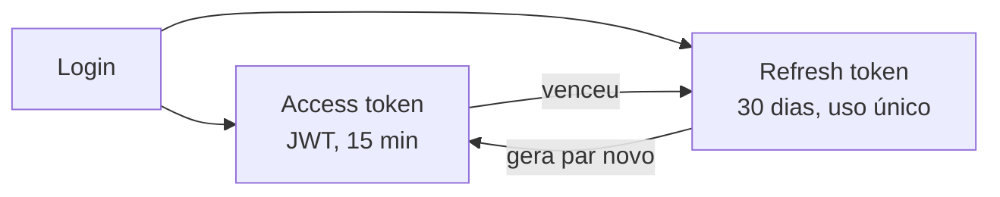

# Decisões de arquitetura

O que decidimos, por quê e o que deixamos de lado. Cada decisão cabe em poucas linhas; os
detalhes estão no código, comentados.

---

## Estrutura

### 1. MVC, com as regras de negócio em `services/`

O MVC é requisito da disciplina. Controllers, Views e Models ficam em pastas separadas
(ver [Visão geral](index.md#arquitetura-mvc)).

- **Por quê `services/`:** se as regras ficassem dentro dos controllers, misturariam HTTP com
  regra de negócio e seriam difíceis de testar. Em `services/`, fazem parte da camada Model e
  podem ser testadas sem HTTP.
- **Descartado:** colocar a regra dentro do model (o "model gordo" do MVC clássico). Com
  SQLAlchemy, isso acopla a regra à sessão do banco.

### 2. FastAPI

- Gera o Swagger sozinho a partir do código: o time do app consulta `/docs` em vez de uma
  documentação escrita à mão que fica desatualizada.
- Valida o JSON de entrada com Pydantic (a camada View) sem código extra.

### 3. PostgreSQL de verdade, inclusive nos testes

A busca do acervo (US07) vai ignorar acentos e maiúsculas, com as extensões `unaccent` e
`pg_trgm`. O SQLite não tem essas extensões, então os testes rodam contra um PostgreSQL real
(no Docker e no CI). Cada teste roda numa transação desfeita no fim, assim um teste nunca vê
os dados de outro.

### 4. Rotas versionadas em `/api/v1`

Um app publicado na loja não é atualizado na hora. Se um dia o contrato mudar de forma
incompatível, a versão nova vai para `/api/v2` e os celulares com o app antigo continuam
funcionando.

---

## Contas e acesso

### 5. Uma tabela só para professor e admin

Os dois têm e-mail, senha e sessão iguais; muda só o que podem fazer. A coluna `role`
(`teacher` ou `admin`) resolve isso, como pedem as notas técnicas da issue da US05. Uma tabela por perfil
duplicaria login, sessão e redefinição de senha.

### 6. Convite por e-mail, sem senha gerada pelo sistema

A editora informa só o e-mail. O professor recebe um link e, nele, preenche nome, escola e a
senha que quiser.

- **Por quê:** uma senha gerada e enviada por mensagem fica no histórico do WhatsApp/e-mail e
  é conhecida por quem a enviou. Com o convite, só o professor conhece a senha. E quem
  preenche os próprios dados é quem os conhece.
- **O link também volta para a editora**, para ela reenviar por WhatsApp se o e-mail cair no
  spam.
- **Nome obrigatório, escola opcional:** o nome aparece no cabeçalho (US10). A escola pode
  ser preenchida depois.

### 7. Tokens de convite e redefinição guardados como hash

O link carrega um token aleatório. O banco guarda só o **hash (SHA-256)** dele, como se faz
com senhas. Se o banco vazar, ninguém consegue montar um link válido.

Cada token é de **uso único**, tem validade (convite: 72 h; redefinição: 30 min) e, ao gerar
um novo, os anteriores são apagados: só o link mais recente vale.

### 8. Sessão com dois tokens

- **Access token curto (JWT):** a API confere sem ir ao banco. Se for roubado, vale por pouco
  tempo.
- **Refresh token longo, guardado no banco:** é o que permite o **logout de verdade** (basta
  revogá-lo) e manter o professor logado por 30 dias.
- **Rotação:** cada refresh gera um novo e invalida o anterior. Se um refresh antigo for usado
  de novo, alguém o copiou, e a API encerra todas as sessões daquela conta.

### 9. Senhas com Argon2

Argon2 é o algoritmo recomendado hoje para senhas: é lento de propósito, o que torna inviável
testar milhões de senhas por segundo num vazamento. Exigimos de 8 a 128 caracteres (o teto
evita que uma senha gigante sobrecarregue o servidor).

### 10. Não revelar quais contas existem

- Login errado responde sempre "credenciais inválidas", sem dizer se o erro foi no e-mail ou
  na senha. O tempo de resposta também é o mesmo: a senha é conferida mesmo quando o e-mail
  não existe.
- "Esqueci minha senha" e "reenviar convite" respondem sempre a mesma mensagem.

### 11. Limite de tentativas

Login, redefinição e convites aceitam poucas tentativas por minuto por IP (de 5 a 30, conforme
a rota). Isso impede alguém de testar senhas ou tokens em massa.

---

## Integração

### 12. Formato único de erro com `code`

Todo erro responde `{code, message, details}`. O app decide a tela pelo `code` (por exemplo,
`INVITE_EXPIRED` mostra o botão "Pedir novo link"), e não pelo texto, que pode mudar.
Ver [API](api.md#formato-de-erro).

### 13. E-mail atrás de uma interface

O provedor de e-mail ainda não foi escolhido. O código depende só de uma interface com um
método `send`. Hoje a implementação escreve o e-mail no log (em produção, sem o link, para não
expô-lo). Trocar pelo provedor real é criar uma classe nova, sem mexer nas regras.

### 14. Links `collibooks://` + código para colar

Sem domínio próprio, o link usa o esquema do app. Como nem todo app de mensagem deixa clicar
nesse tipo de link, o e-mail também traz o código. Quando houver domínio, a troca é uma
variável de ambiente (`APP_LINK_BASE_URL`).

---

## Pendências conhecidas

| Item | Impacto | Como resolver |
| --- | --- | --- |
| Provedor de e-mail | Sem ele, ninguém recebe convite nem redefinição | Escolher o provedor e implementar `send` |
| Domínio para os links | Links `collibooks://` não abrem em alguns apps | Domínio + `APP_LINK_BASE_URL=https://...` |
| Sessão após trocar a senha | Access token antigo vale até 15 min | Guardar a data da troca de senha e recusar tokens anteriores |
| Tempo do "Esqueci minha senha" | Conta ativa responde um pouco mais devagar | Enviar o e-mail em segundo plano |
| `/health` | Devolve a mensagem de erro do banco | Responder texto fixo e registrar o erro no log |
| Hospedagem | Ainda sem servidor definido ([pontos a confirmar](../cliente/pontos-a-confirmar.md)) | Definir com a editora |
