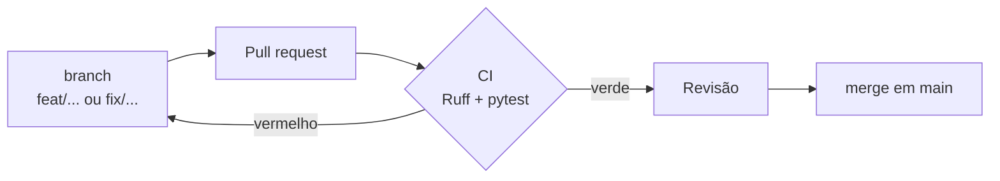

# Como rodar e contribuir

## Rodar localmente

Requisitos: Docker e Python 3.12.

```bash
cp .env.example .env
docker compose up --build -d  # banco em localhost:5432 e API em localhost:8000
docker compose exec backend alembic upgrade head
```

- API: <http://localhost:8000>
- Swagger: <http://localhost:8000/docs>

Criar o administrador (pede a senha no terminal; pode rodar de novo sem duplicar):

```bash
docker compose exec backend python -m app.cli seed-admin --email admin@colli.com --name "Editora Colli"
```

!!! info "E-mails no desenvolvimento"
    Ainda não há provedor de e-mail. Os convites e links de redefinição aparecem no log:
    `docker compose logs -f backend`.

---

## Testes

```bash
python -m venv .venv && source .venv/bin/activate
pip install -r requirements-dev.txt
docker compose up -d db
pytest                                   # testes
ruff check . && ruff format --check .    # padrão de código
```

Os testes criam um banco próprio (`colli_books_test`), aplicam as migrations e desfazem tudo
ao final de cada teste.

---

## Fluxo de trabalho



- **Branches:** `feat/` para funcionalidade, `fix/` para correção, `refactor/`, `chore/`, `docs/`.
- **Commits** em português, no padrão Conventional Commits: `feat: cadastro de professor`.
- **CI** (GitHub Actions) roda o Ruff e os testes contra PostgreSQL em todo pull request.
- **Banco:** toda mudança de tabela vira uma migration nova em `alembic/versions/`. Um teste
  confere se as migrations e os models batem.
- **Código novo segue o MVC:** rota em `controllers/`, JSON em `views/`, regra em `services/`,
  tabela em `models/`.

---

## Variáveis de ambiente

| Variável | Padrão | Para quê |
| --- | --- | --- |
| `APP_ENV` | `development` | `production` em produção (ativa as checagens de segurança) |
| `DATABASE_URL` | banco do Docker | Conexão com o PostgreSQL |
| `JWT_SECRET` | segredo de desenvolvimento | **Obrigatório em produção**, com 32+ caracteres |
| `APP_LINK_BASE_URL` | `collibooks://` | Início dos links de convite e redefinição |
| `INVITE_TTL_HOURS` | `72` | Validade do convite |
| `PASSWORD_RESET_TTL_MINUTES` | `30` | Validade do link de redefinição |
