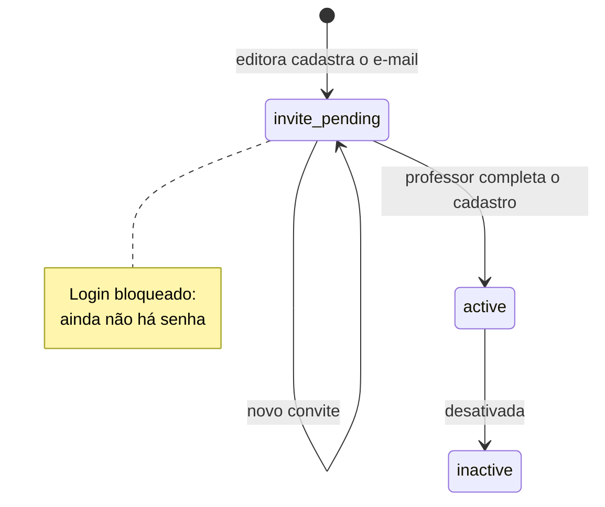
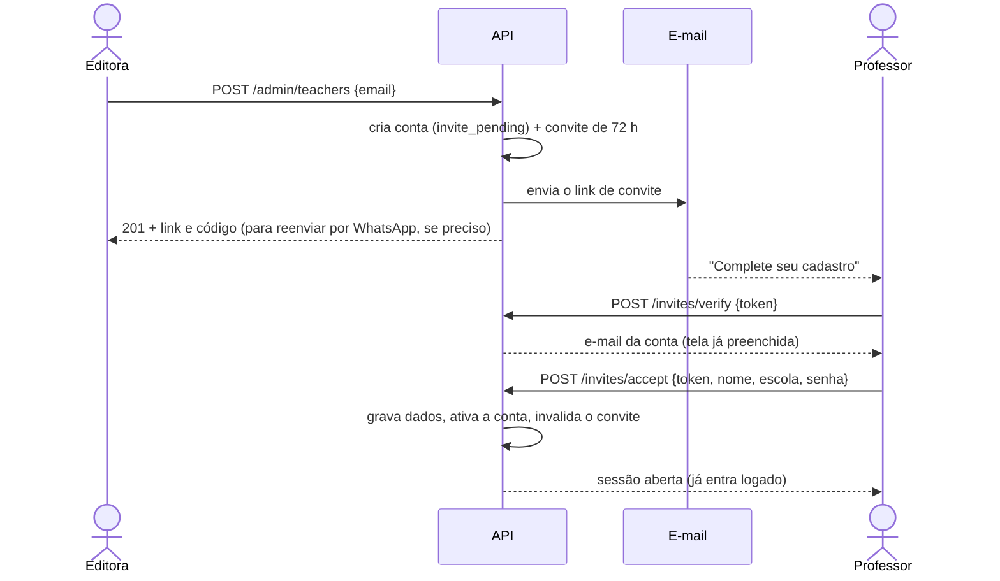
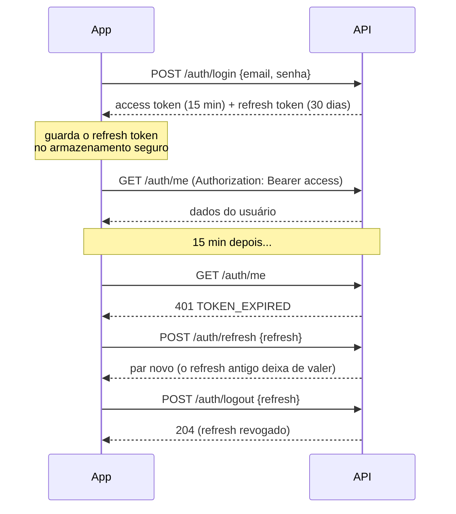
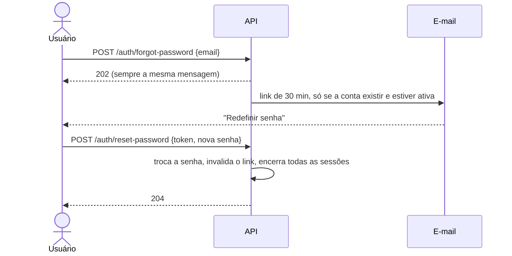

# Fluxos de acesso

Como funcionam, por dentro, as histórias do [Épico 1](../backlog/epico-1-acesso.md).

---

## Estados de uma conta

O estado `inactive` já existe no banco, mas ainda não há tela nem rota que desative uma conta.

---

## Cadastro do professor (US01 e US02)

A editora informa **só o e-mail**. O professor recebe o convite no e-mail dele e, pelo link,
preenche o que falta: **nome** (obrigatório), **escola** (opcional) e a **senha** que escolher.
Ninguém além dele conhece a senha.

**Casos de erro do convite**

| Situação | Resposta | O que o app mostra |
| --- | --- | --- |
| Token não existe (ou foi substituído por um novo) | `404 INVITE_INVALID` | "Convite inválido" |
| Já foi usado | `409 INVITE_ALREADY_USED` | Orientar a fazer login ou usar "Esqueci minha senha" |
| Passou de 72 h | `410 INVITE_EXPIRED` | Botão "Pedir novo link" → `POST /invites/resend` |

O reenvio só funciona para convite **expirado** e o link novo vai **só para o e-mail**, nunca
na resposta. Assim, quem encontrar um link antigo não ganha acesso.

---

## Login, sessão e logout (US03 e US05)

Professor e administrador usam a mesma tela e a mesma rota. O campo `role` da resposta diz ao
app se ele deve mostrar o painel administrativo.

- **Credencial errada** sempre responde `401 INVALID_CREDENTIALS`, sem dizer se o e-mail existe.
- **Refresh reutilizado** (um token que já foi trocado) indica roubo: a API derruba **todas**
  as sessões daquele usuário.
- O **administrador** é criado direto no banco pelo comando `seed-admin`; não existe tela de
  cadastro de administrador (US05).

---

## Esqueci minha senha (US04 e US06)

A resposta é **sempre igual**, exista o e-mail ou não. Assim ninguém consegue descobrir quem
tem conta.
