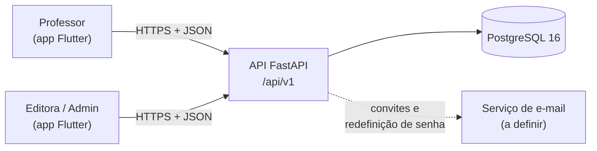
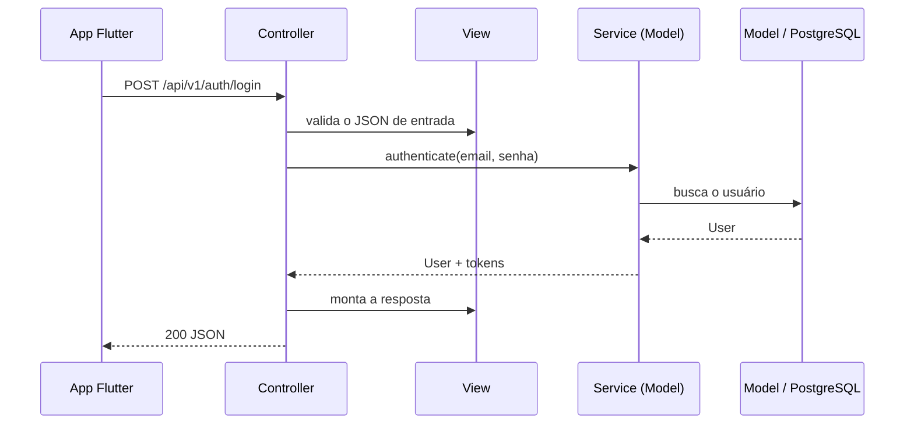

# Backend: visão geral

O backend é uma **API REST** que o app Flutter consome. Ele guarda as contas, controla
quem pode entrar e, nas próximas fases, servirá o acervo.

Código: [`colli-books-backend`](https://github.com/Colli-Books/colli-books-backend).
Com a API rodando, a documentação interativa (Swagger) fica em `/docs`; o deploy de
demonstração está em <https://colli-books-backend-ixvf.vercel.app/docs>.

---

## Onde ele se encaixa



---

## Arquitetura MVC

O projeto segue o padrão **Model-View-Controller**, requisito da disciplina. Cada camada
tem uma pasta própria em `app/`:

| Camada | Pasta | O que faz |
| --- | --- | --- |
| **Model** | `models/` + `services/` | `models/`: as tabelas (SQLAlchemy). `services/`: as regras de negócio (quem pode entrar, quando um convite expira…) |
| **View** | `views/` | O formato do JSON que a API recebe e devolve (Pydantic) |
| **Controller** | `controllers/` | Recebe a requisição HTTP, chama o Model e devolve a View. Não tem regra de negócio |

A tela que o usuário vê é o app Flutter. Para o backend, a "View" é o JSON entregue a ele.

### Caminho de uma requisição



!!! tip "Por que as regras ficam em `services/` e não nos controllers?"
    Assim dá para testar uma regra (por exemplo, "convite expirado não pode ser aceito")
    sem subir HTTP, e o controller fica com uma única função: traduzir HTTP. Os services
    fazem parte da camada Model.

---

## Pastas

```
app/
├── main.py          # cria a aplicação e registra os controllers
├── config.py        # configuração lida de variáveis de ambiente
├── database.py      # conexão com o banco
├── errors.py        # formato padrão de erro
├── models/          # MODEL: tabelas
├── services/        # MODEL: regras de negócio
├── views/           # VIEW: JSON de entrada e saída
├── controllers/     # CONTROLLER: rotas HTTP
└── security/        # hash de senha, JWT e "quem está logado"
alembic/versions/    # migrations do banco
tests/               # historias/ (aceitação por história de usuário) e infra/ (health, migrations, seed)
```

---

## Tecnologias

| Tecnologia | Uso |
| --- | --- |
| Python 3.12 + **FastAPI** | API e documentação automática (Swagger) |
| **PostgreSQL 16** | Banco de dados |
| **SQLAlchemy 2** + **Alembic** | Acesso ao banco e migrations versionadas |
| **Pydantic** | Validação do JSON (camada View) |
| **PyJWT** | Access token da sessão |
| **pwdlib** (Argon2) | Hash de senha |
| **slowapi** | Limite de tentativas por minuto |
| **pytest** + **Ruff** | Testes e padronização do código, rodando no GitHub Actions |
| **Docker Compose** | Sobe banco e API localmente |

Os motivos de cada escolha estão em [Decisões de arquitetura](decisoes.md).
